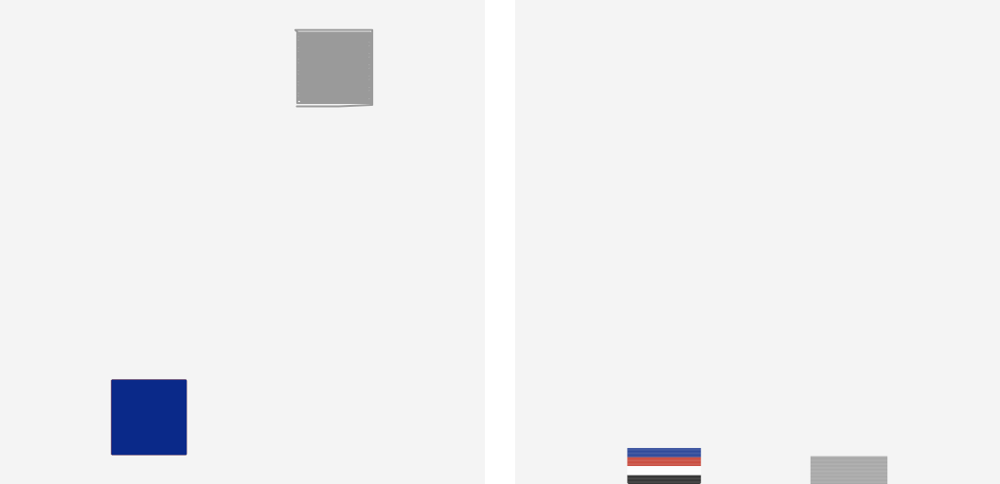
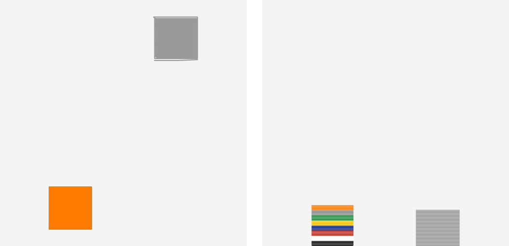
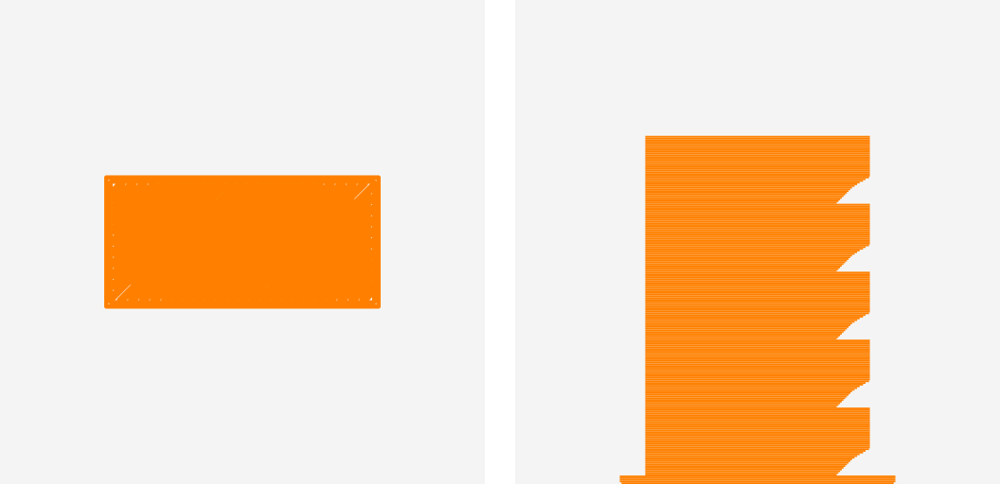

# Examples

Generated by `tests/make_examples_doc.py` from `examples/*.toml`; do not edit by hand. Each job is built, sliced in real headless Bambu Studio and graded in CI, see [support-matrix.md](support-matrix.md). That is CI-verified, not print-tested.

Run one: `python3 scripts/build_bambu_3mf.py examples/NAME.toml --out NAME.3mf`

## single_p1s

One part, one filament, P1S. The smallest useful job.

Top view (left) and front view (right) of what Studio sliced, drawn from the G-code (`tests/make_gallery.py`):


Job (`examples/single_p1s.toml`):

```toml
studio  = "2.8.2"
output  = "single_p1s.3mf"
printer = "Bambu Lab P1S 0.4 nozzle"
process = "0.20mm Standard @BBL X1C"

[[filament]]
preset = "Bambu PLA Basic @BBL P1S 0.4 nozzle"
color = "#C12E1F"

[[object]]
name = "Cube"
[[object.part]]
mesh = "data/cube20.stl"
filament = 1
```

Builder summary:

```
  Bambu Studio 2.8.2.61 | Bambu Lab P1S 0.4 nozzle | 0.20mm Standard @BBL X1C
  Plate type: Cool Plate
  Walls 2, infill 15% rectilinear, layer 0.2 mm

Filaments
  1  #C12E1F  Bambu PLA Basic @BBL P1S 0.4 nozzle  nozzle 220 C  flow 0.98

Plates
  plate 1: Cube x1, 20 x 20 x 20 mm; Part 1 (filament 1)
```

## single_p1p

Same on a P1P.

Top view (left) and front view (right) of what Studio sliced, drawn from the G-code (`tests/make_gallery.py`):


Job (`examples/single_p1p.toml`):

```toml
studio  = "2.8.2"
output  = "single_p1p.3mf"
printer = "Bambu Lab P1P 0.4 nozzle"
process = "0.20mm Standard @BBL P1P"

[[filament]]
preset = "Bambu PLA Basic @BBL P1P"
color = "#C12E1F"

[[object]]
name = "Cube"
[[object.part]]
mesh = "data/cube20.stl"
filament = 1
```

Builder summary:

```
  Bambu Studio 2.8.2.61 | Bambu Lab P1P 0.4 nozzle | 0.20mm Standard @BBL P1P
  Plate type: Cool Plate
  Walls 2, infill 15% rectilinear, layer 0.2 mm

Filaments
  1  #C12E1F  Bambu PLA Basic @BBL P1P  nozzle 220 C  flow 0.98

Plates
  plate 1: Cube x1, 20 x 20 x 20 mm; Part 1 (filament 1)
```

## single_a1

Same on an A1.

Top view (left) and front view (right) of what Studio sliced, drawn from the G-code (`tests/make_gallery.py`):


Job (`examples/single_a1.toml`):

```toml
studio  = "2.8.2"
output  = "single_a1.3mf"
printer = "Bambu Lab A1 0.4 nozzle"
process = "0.20mm Standard @BBL A1"

[[filament]]
preset = "Bambu PLA Basic @BBL A1"
color = "#C12E1F"

[[object]]
name = "Cube"
[[object.part]]
mesh = "data/cube20.stl"
filament = 1
```

Builder summary:

```
  Bambu Studio 2.8.2.61 | Bambu Lab A1 0.4 nozzle | 0.20mm Standard @BBL A1
  Plate type: Cool Plate
  Walls 2, infill 15% rectilinear, layer 0.2 mm

Filaments
  1  #C12E1F  Bambu PLA Basic @BBL A1  nozzle 220 C  flow 0.98

Plates
  plate 1: Cube x1, 20 x 20 x 20 mm; Part 1 (filament 1)
```

## single_x1c

Same on an X1 Carbon.

Top view (left) and front view (right) of what Studio sliced, drawn from the G-code (`tests/make_gallery.py`):


Job (`examples/single_x1c.toml`):

```toml
studio  = "2.8.2"
output  = "single_x1c.3mf"
printer = "Bambu Lab X1 Carbon 0.4 nozzle"
process = "0.20mm Standard @BBL X1C"

[[filament]]
preset = "Bambu PLA Basic @BBL X1C"
color = "#C12E1F"

[[object]]
name = "Cube"
[[object.part]]
mesh = "data/cube20.stl"
filament = 1
```

Builder summary:

```
  Bambu Studio 2.8.2.61 | Bambu Lab X1 Carbon 0.4 nozzle | 0.20mm Standard @BBL X1C
  Plate type: Cool Plate
  Walls 2, infill 15% rectilinear, layer 0.2 mm

Filaments
  1  #C12E1F  Bambu PLA Basic @BBL X1C  nozzle 220 C  flow 0.98

Plates
  plate 1: Cube x1, 20 x 20 x 20 mm; Part 1 (filament 1)
```

## colors_2

Two colors from two parts. Prime tower and purge volumes are added.

Top view (left) and front view (right) of what Studio sliced, drawn from the G-code (`tests/make_gallery.py`):


Job (`examples/colors_2.toml`):

```toml
studio  = "2.8.2"
output  = "colors_2.3mf"
printer = "Bambu Lab P1S 0.4 nozzle"
process = "0.20mm Standard @BBL X1C"

[[filament]]
preset = "Bambu PLA Basic @BBL P1S 0.4 nozzle"
color = "#111111"

[[filament]]
preset = "Bambu PLA Basic @BBL P1S 0.4 nozzle"
color = "#FFFFFF"

[[object]]
name = "Multi"
[[object.part]]
name = "Part 1"
mesh = "data/slab1.stl"
filament = 1
[[object.part]]
name = "Part 2"
mesh = "data/slab2.stl"
filament = 2
```

Builder summary:

```
  Bambu Studio 2.8.2.61 | Bambu Lab P1S 0.4 nozzle | 0.20mm Standard @BBL X1C
  Plate type: Cool Plate
  Walls 2, infill 15% rectilinear, layer 0.2 mm

Filaments
  1  #111111  Bambu PLA Basic @BBL P1S 0.4 nozzle  nozzle 220 C  flow 0.98
  2  #FFFFFF  Bambu PLA Basic @BBL P1S 0.4 nozzle  nozzle 220 C  flow 0.98

Plates
  plate 1: Multi x1, 20 x 20 x 4.8 mm; Part 1 (filament 1), Part 2 (filament 2)

Purge per color change, grams (from filament in the row to filament in the column; approximate)
             1       2
    1        -    0.75
    2     0.17       -
  Wipe tower: x 165, y 220.697 (plate 1)
  Largest single purge 0.75 g. Mode: auto
```

## colors_4

Four colors, one part per color.

Top view (left) and front view (right) of what Studio sliced, drawn from the G-code (`tests/make_gallery.py`):



Job (`examples/colors_4.toml`):

```toml
studio  = "2.8.2"
output  = "colors_4.3mf"
printer = "Bambu Lab P1S 0.4 nozzle"
process = "0.20mm Standard @BBL X1C"

[[filament]]
preset = "Bambu PLA Basic @BBL P1S 0.4 nozzle"
color = "#111111"

[[filament]]
preset = "Bambu PLA Basic @BBL P1S 0.4 nozzle"
color = "#FFFFFF"

[[filament]]
preset = "Bambu PLA Basic @BBL P1S 0.4 nozzle"
color = "#C12E1F"

[[filament]]
preset = "Bambu PLA Basic @BBL P1S 0.4 nozzle"
color = "#0A2989"

[[object]]
name = "Multi"
[[object.part]]
name = "Part 1"
mesh = "data/slab1.stl"
filament = 1
[[object.part]]
name = "Part 2"
mesh = "data/slab2.stl"
filament = 2
[[object.part]]
name = "Part 3"
mesh = "data/slab3.stl"
filament = 3
[[object.part]]
name = "Part 4"
mesh = "data/slab4.stl"
filament = 4
```

Builder summary:

```
  Bambu Studio 2.8.2.61 | Bambu Lab P1S 0.4 nozzle | 0.20mm Standard @BBL X1C
  Plate type: Cool Plate
  Walls 2, infill 15% rectilinear, layer 0.2 mm

Filaments
  1  #111111  Bambu PLA Basic @BBL P1S 0.4 nozzle  nozzle 220 C  flow 0.98
  2  #FFFFFF  Bambu PLA Basic @BBL P1S 0.4 nozzle  nozzle 220 C  flow 0.98
  3  #C12E1F  Bambu PLA Basic @BBL P1S 0.4 nozzle  nozzle 220 C  flow 0.98
  4  #0A2989  Bambu PLA Basic @BBL P1S 0.4 nozzle  nozzle 220 C  flow 0.98

Plates
  plate 1: Multi x1, 20 x 20 x 9.6 mm; Part 1 (filament 1), Part 2 (filament 2), Part 3 (filament 3), Part 4 (filament 4)

Purge per color change, grams (from filament in the row to filament in the column; approximate)
             1       2       3       4
    1        -    0.75    0.49    0.33
    2     0.17       -    0.30    0.28
    3     0.18    0.71       -    0.27
    4     0.15    0.78    0.50       -
  Wipe tower: x 165, y 209.362 (plate 1)
  Largest single purge 0.78 g. Mode: auto
```

## colors_8

Eight colors: eight parts, eight filament slots.

Top view (left) and front view (right) of what Studio sliced, drawn from the G-code (`tests/make_gallery.py`):



Job (`examples/colors_8.toml`):

```toml
studio  = "2.8.2"
output  = "colors_8.3mf"
printer = "Bambu Lab P1S 0.4 nozzle"
process = "0.20mm Standard @BBL X1C"

[[filament]]
preset = "Bambu PLA Basic @BBL P1S 0.4 nozzle"
color = "#111111"

[[filament]]
preset = "Bambu PLA Basic @BBL P1S 0.4 nozzle"
color = "#FFFFFF"

[[filament]]
preset = "Bambu PLA Basic @BBL P1S 0.4 nozzle"
color = "#C12E1F"

[[filament]]
preset = "Bambu PLA Basic @BBL P1S 0.4 nozzle"
color = "#0A2989"

[[filament]]
preset = "Bambu PLA Basic @BBL P1S 0.4 nozzle"
color = "#F5C400"

[[filament]]
preset = "Bambu PLA Basic @BBL P1S 0.4 nozzle"
color = "#1E8E3E"

[[filament]]
preset = "Bambu PLA Basic @BBL P1S 0.4 nozzle"
color = "#8A8A8A"

[[filament]]
preset = "Bambu PLA Basic @BBL P1S 0.4 nozzle"
color = "#FF7A00"

[[object]]
name = "Multi"
[[object.part]]
name = "Part 1"
mesh = "data/slab1.stl"
filament = 1
[[object.part]]
name = "Part 2"
mesh = "data/slab2.stl"
filament = 2
[[object.part]]
name = "Part 3"
mesh = "data/slab3.stl"
filament = 3
[[object.part]]
name = "Part 4"
mesh = "data/slab4.stl"
filament = 4
[[object.part]]
name = "Part 5"
mesh = "data/slab5.stl"
filament = 5
[[object.part]]
name = "Part 6"
mesh = "data/slab6.stl"
filament = 6
[[object.part]]
name = "Part 7"
mesh = "data/slab7.stl"
filament = 7
[[object.part]]
name = "Part 8"
mesh = "data/slab8.stl"
filament = 8
```

Builder summary:

```
  Bambu Studio 2.8.2.61 | Bambu Lab P1S 0.4 nozzle | 0.20mm Standard @BBL X1C
  Plate type: Cool Plate
  Walls 2, infill 15% rectilinear, layer 0.2 mm

Filaments
  1  #111111  Bambu PLA Basic @BBL P1S 0.4 nozzle  nozzle 220 C  flow 0.98
  2  #FFFFFF  Bambu PLA Basic @BBL P1S 0.4 nozzle  nozzle 220 C  flow 0.98
  3  #C12E1F  Bambu PLA Basic @BBL P1S 0.4 nozzle  nozzle 220 C  flow 0.98
  4  #0A2989  Bambu PLA Basic @BBL P1S 0.4 nozzle  nozzle 220 C  flow 0.98
  5  #F5C400  Bambu PLA Basic @BBL P1S 0.4 nozzle  nozzle 220 C  flow 0.98
  6  #1E8E3E  Bambu PLA Basic @BBL P1S 0.4 nozzle  nozzle 220 C  flow 0.98
  7  #8A8A8A  Bambu PLA Basic @BBL P1S 0.4 nozzle  nozzle 220 C  flow 0.98
  8  #FF7A00  Bambu PLA Basic @BBL P1S 0.4 nozzle  nozzle 220 C  flow 0.98

Plates
  plate 1: Multi x1, 20 x 20 x 19.2 mm; Part 1 (filament 1), Part 2 (filament 2), Part 3 (filament 3), Part 4 (filament 4), Part 5 (filament 5), Part 6 (filament 6), Part 7 (filament 7), Part 8 (filament 8)

Purge per color change, grams (from filament in the row to filament in the column; approximate)
             1       2       3       4       5       6       7       8
    1        -    0.75    0.49    0.33    0.80    0.48    0.50    0.72
    2     0.17       -    0.30    0.28    0.37    0.25    0.15    0.39
    3     0.18    0.71       -    0.27    0.57    0.41    0.43    0.43
    4     0.15    0.78    0.50       -    0.80    0.46    0.42    0.71
    5     0.23    0.56    0.29    0.31       -    0.30    0.29    0.18
    6     0.17    0.65    0.28    0.25    0.64       -    0.35    0.58
    7     0.15    0.49    0.27    0.25    0.52    0.21       -    0.41
    8     0.22    0.66    0.23    0.30    0.34    0.29    0.28       -
  Wipe tower: x 165, y 195.657 (plate 1)
  Largest single purge 0.80 g. Mode: auto
```

## modifier_negative

A modifier part (80% infill in the lower half) and a negative part (a hole) on one body.

Top view (left) and front view (right) of what Studio sliced, drawn from the G-code (`tests/make_gallery.py`):


Job (`examples/modifier_negative.toml`):

```toml
studio  = "2.8.2"
output  = "modifier_negative.3mf"
printer = "Bambu Lab P1S 0.4 nozzle"
process = "0.20mm Standard @BBL X1C"

[[filament]]
preset = "Bambu PLA Basic @BBL P1S 0.4 nozzle"
color = "#FF8000"

[[object]]
name = "Body"
[[object.part]]
name = "Body"
mesh = "data/cube20.stl"
filament = 1
[[object.part]]
name = "Mod"
mesh = "data/lower_half.stl"
type = "modifier_part"
units = "mm"
[object.part.settings]
sparse_infill_density = "80%"
[[object.part]]
name = "Hole"
mesh = "data/hole8.stl"
type = "negative_part"
```

Builder summary:

```
  Bambu Studio 2.8.2.61 | Bambu Lab P1S 0.4 nozzle | 0.20mm Standard @BBL X1C
  Plate type: Cool Plate
  Walls 2, infill 15% rectilinear, layer 0.2 mm

Filaments
  1  #FF8000  Bambu PLA Basic @BBL P1S 0.4 nozzle  nozzle 220 C  flow 0.98

Plates
  plate 1: Body x1, 20 x 20 x 20 mm; Body (filament 1), Mod (filament 1), Hole (filament 1)
```

## inlay_no_penetration

Studio 2.9.2: a body part and an inlay part with `color_penetration_cross_parts = false` on the object. The setting acts only on painted color, so these unpainted parts slice the same with it on or off (see references/multicolor.md).

Job (`examples/inlay_no_penetration.toml`):

```toml
studio  = "2.9.2"
output  = "inlay_no_penetration.3mf"
printer = "Bambu Lab P1S 0.4 nozzle"
process = "0.20mm Standard @BBL X1C"

[[filament]]
preset = "Bambu PLA Basic @BBL P1S 0.4 nozzle"
color = "#F2F2F2"

[[filament]]
preset = "Bambu PLA Basic @BBL P1S 0.4 nozzle"
color = "#C12E1F"

# Acts only on color painted in Studio. These parts are not painted, so the tool paths are the same with it on or off.
[[object]]
name = "Body and inlay"
[object.settings]
color_penetration_cross_parts = false
[[object.part]]
name = "Body"
mesh = "data/slab1.stl"
filament = 1
[[object.part]]
name = "Inlay"
mesh = "data/slab2.stl"
filament = 2
```

Builder summary:

```
  Bambu Studio 2.9.2.62 | Bambu Lab P1S 0.4 nozzle | 0.20mm Standard @BBL X1C
  Plate type: Cool Plate
  Walls 2, infill 15% rectilinear, layer 0.2 mm

Filaments
  1  #F2F2F2  Bambu PLA Basic @BBL P1S 0.4 nozzle  nozzle 220 C  flow 0.98
  2  #C12E1F  Bambu PLA Basic @BBL P1S 0.4 nozzle  nozzle 220 C  flow 0.98

Plates
  plate 1: Body and inlay x1, 20 x 20 x 4.8 mm; Body (filament 1), Inlay (filament 2)

Purge per color change, grams (from filament in the row to filament in the column; approximate)
             1       2
    1        -    0.30
    2     0.69       -
  Wipe tower: x 165, y 220.697 (plate 1)
  Largest single purge 0.69 g. Mode: auto
```

## seam_headroom

Two colors with the embedded seam headroom set to 20 mm (the P1S presets use 10 mm). Needs Studio 2.9.2.

Job (`examples/seam_headroom.toml`):

```toml
studio  = "2.9.2"
output  = "seam_headroom.3mf"
printer = "Bambu Lab P1S 0.4 nozzle"
process = "0.20mm Standard @BBL X1C"

# The P1S process presets set seam_headroom to 10 mm. This job asks for 20 mm.
[settings]
seam_headroom = 20

[[filament]]
preset = "Bambu PLA Basic @BBL P1S 0.4 nozzle"
color = "#111111"

[[filament]]
preset = "Bambu PLA Basic @BBL P1S 0.4 nozzle"
color = "#FFFFFF"

[[object]]
name = "Inlay"
[[object.part]]
name = "Part 1"
mesh = "data/slab1.stl"
filament = 1
[[object.part]]
name = "Part 2"
mesh = "data/slab2.stl"
filament = 2
```

Builder summary:

```
  Bambu Studio 2.9.2.62 | Bambu Lab P1S 0.4 nozzle | 0.20mm Standard @BBL X1C
  Plate type: Cool Plate
  Walls 2, infill 15% rectilinear, layer 0.2 mm

Filaments
  1  #111111  Bambu PLA Basic @BBL P1S 0.4 nozzle  nozzle 220 C  flow 0.98
  2  #FFFFFF  Bambu PLA Basic @BBL P1S 0.4 nozzle  nozzle 220 C  flow 0.98

Plates
  plate 1: Inlay x1, 20 x 20 x 4.8 mm; Part 1 (filament 1), Part 2 (filament 2)

Purge per color change, grams (from filament in the row to filament in the column; approximate)
             1       2
    1        -    0.75
    2     0.17       -
  Wipe tower: x 165, y 220.697 (plate 1)
  Largest single purge 0.75 g. Mode: auto
```

## multi_plate

Two objects on two plates.

Top view (left) and front view (right) of what Studio sliced, drawn from the G-code (`tests/make_gallery.py`):


Job (`examples/multi_plate.toml`):

```toml
studio  = "2.8.2"
output  = "multi_plate.3mf"
printer = "Bambu Lab P1S 0.4 nozzle"
process = "0.20mm Standard @BBL X1C"

[[filament]]
preset = "Bambu PLA Basic @BBL P1S 0.4 nozzle"
color = "#FF8000"

[[object]]
name = "A"
plate = 1
[[object.part]]
mesh = "data/cube20.stl"
filament = 1

[[object]]
name = "B"
plate = 2
[[object.part]]
mesh = "data/cube20.stl"
filament = 1
```

Builder summary:

```
  Bambu Studio 2.8.2.61 | Bambu Lab P1S 0.4 nozzle | 0.20mm Standard @BBL X1C
  Plate type: Cool Plate
  Walls 2, infill 15% rectilinear, layer 0.2 mm

Filaments
  1  #FF8000  Bambu PLA Basic @BBL P1S 0.4 nozzle  nozzle 220 C  flow 0.98

Plates
  plate 1: A x1, 20 x 20 x 20 mm; Part 1 (filament 1)
  plate 2: B x1, 20 x 20 x 20 mm; Part 1 (filament 1)
```

## pause

A pause at 10 mm (for example to insert a magnet).

Top view (left) and front view (right) of what Studio sliced, drawn from the G-code (`tests/make_gallery.py`):


Job (`examples/pause.toml`):

```toml
studio  = "2.8.2"
output  = "pause.3mf"
printer = "Bambu Lab P1S 0.4 nozzle"
process = "0.20mm Standard @BBL X1C"

[[filament]]
preset = "Bambu PLA Basic @BBL P1S 0.4 nozzle"
color = "#FF8000"

[[layer_gcode]]
z = 10.0
pause = true

[[object]]
name = "Cube"
[[object.part]]
mesh = "data/cube20.stl"
filament = 1
```

Builder summary:

```
  Bambu Studio 2.8.2.61 | Bambu Lab P1S 0.4 nozzle | 0.20mm Standard @BBL X1C
  Plate type: Cool Plate
  Walls 2, infill 15% rectilinear, layer 0.2 mm

Filaments
  1  #FF8000  Bambu PLA Basic @BBL P1S 0.4 nozzle  nozzle 220 C  flow 0.98

Plates
  plate 1: Cube x1, 20 x 20 x 20 mm; Part 1 (filament 1)

Layer G-code (1 steps)
  plate 1  z 10  pause True
```

## per_object_settings

Two copies of one mesh with different walls and infill.

Top view (left) and front view (right) of what Studio sliced, drawn from the G-code (`tests/make_gallery.py`):


Job (`examples/per_object_settings.toml`):

```toml
studio  = "2.8.2"
output  = "per_object_settings.3mf"
printer = "Bambu Lab P1S 0.4 nozzle"
process = "0.20mm Standard @BBL X1C"

[[filament]]
preset = "Bambu PLA Basic @BBL P1S 0.4 nozzle"
color = "#FF8000"

[[object]]
name = "Strong"
[object.settings]
wall_loops = 5
sparse_infill_density = "40%"
[[object.part]]
mesh = "data/cube20.stl"
filament = 1

[[object]]
name = "Light"
[object.settings]
wall_loops = 2
sparse_infill_density = "5%"
[[object.part]]
mesh = "data/cube20.stl"
filament = 1
```

Builder summary:

```
  Bambu Studio 2.8.2.61 | Bambu Lab P1S 0.4 nozzle | 0.20mm Standard @BBL X1C
  Plate type: Cool Plate
  Walls 2, infill 15% rectilinear, layer 0.2 mm

Filaments
  1  #FF8000  Bambu PLA Basic @BBL P1S 0.4 nozzle  nozzle 220 C  flow 0.98

Plates
  plate 1: Strong x1, 20 x 20 x 20 mm; Part 1 (filament 1)
  plate 1: Light x1, 20 x 20 x 20 mm; Part 1 (filament 1)
```

## height_ranges

Height ranges: 0.12 mm layers for the bottom 2 mm, 0.08 mm layers and 4 walls for the top 3 mm, 0.2 mm in between.

Job (`examples/height_ranges.toml`):

```toml
# Height ranges: fine layers for the bottom and top of a 20 mm cube, normal layers in between,
# and extra walls in the top band. Studio's "height range modifier" (Objects list > Height range).
studio  = "2.8.2"
output  = "height_ranges.3mf"
printer = "Bambu Lab P1S 0.4 nozzle"
process = "0.20mm Standard @BBL X1C"

[[filament]]
preset = "Bambu PLA Basic @BBL P1S 0.4 nozzle"
color = "#2060C0"

[[object]]
name = "Cube with fine ends"
[[object.part]]
mesh = "data/cube20.stl"
filament = 1

[[object.height_range]]          # bottom 2 mm at 0.12 mm
min_z = 0
max_z = 2
layer_height = 0.12

[[object.height_range]]          # top 3 mm at 0.08 mm, 4 walls
min_z = 17
max_z = 20
layer_height = 0.08
[object.height_range.settings]
walls = 4
```

Builder summary:

```
  Bambu Studio 2.8.2.61 | Bambu Lab P1S 0.4 nozzle | 0.20mm Standard @BBL X1C
  Plate type: Cool Plate
  Walls 2, infill 15% rectilinear, layer 0.2 mm

Filaments
  1  #2060C0  Bambu PLA Basic @BBL P1S 0.4 nozzle  nozzle 220 C  flow 0.98

Plates
  plate 1: Cube with fine ends x1, 20 x 20 x 20 mm; Part 1 (filament 1)
    height 0-2 mm: layer 0.12 mm
    height 17-20 mm: layer 0.08 mm, wall_loops 4
```

## purge_matrix

Two colors with a hand-set purge matrix: 1200 mm3 from slot 1 to slot 2 (above 900, so Studio 2.9.2) and 300 mm3 back.

Job (`examples/purge_matrix.toml`):

```toml
studio  = "2.9.2"
output  = "purge_matrix.3mf"
printer = "Bambu Lab P1S 0.4 nozzle"
process = "0.20mm Standard @BBL X1C"

# Hand-set purge volumes in mm3, from slot > to slot. Other pairs keep Studio's color-based values.
# 1200 mm3 is above 900, so this job needs Studio 2.9.2.
purge = { "1>2" = 1200, "2>1" = 300 }

[[filament]]
preset = "Bambu PLA Basic @BBL P1S 0.4 nozzle"
color = "#111111"

[[filament]]
preset = "Bambu PLA Basic @BBL P1S 0.4 nozzle"
color = "#FFFFFF"

[[object]]
name = "Multi"
[[object.part]]
name = "Part 1"
mesh = "data/slab1.stl"
filament = 1
[[object.part]]
name = "Part 2"
mesh = "data/slab2.stl"
filament = 2
```

Builder summary:

```
  Bambu Studio 2.9.2.62 | Bambu Lab P1S 0.4 nozzle | 0.20mm Standard @BBL X1C
  Plate type: Cool Plate
  Walls 2, infill 15% rectilinear, layer 0.2 mm

Filaments
  1  #111111  Bambu PLA Basic @BBL P1S 0.4 nozzle  nozzle 220 C  flow 0.98
  2  #FFFFFF  Bambu PLA Basic @BBL P1S 0.4 nozzle  nozzle 220 C  flow 0.98

Plates
  plate 1: Multi x1, 20 x 20 x 4.8 mm; Part 1 (filament 1), Part 2 (filament 2)

Purge per color change, grams (from filament in the row to filament in the column; approximate)
             1       2
    1        -    1.51
    2     0.38       -
  Wipe tower: x 165, y 220.697 (plate 1)
  Largest single purge 1.51 g. Mode: manual
```

## effect_plate

The 3D Effect Plate (Studio 2.9.2 or newer) with a bed temperature of 60 C instead of the preset's 55 C.

Job (`examples/effect_plate.toml`):

```toml
studio     = "2.9.2"
output     = "effect_plate.3mf"
printer    = "Bambu Lab P1S 0.4 nozzle"
process    = "0.20mm Standard @BBL X1C"
plate_type = "3D Effect Plate"

[[filament]]
preset = "Bambu PLA Basic @BBL P1S 0.4 nozzle"
color = "#2E6FC1"

[filament.settings]
bed_temp = 60
bed_temp_first_layer = 60

[[object]]
name = "Cube"
[[object.part]]
mesh = "data/cube20.stl"
filament = 1
```

Builder summary:

```
  Bambu Studio 2.9.2.62 | Bambu Lab P1S 0.4 nozzle | 0.20mm Standard @BBL X1C
  Plate type: 3D Effect Plate
  Walls 2, infill 15% rectilinear, layer 0.2 mm

Filaments
  1  #2E6FC1  Bambu PLA Basic @BBL P1S 0.4 nozzle  nozzle 220 C  flow 0.98

Plates
  plate 1: Cube x1, 20 x 20 x 20 mm; Part 1 (filament 1)
```

## ledger_spool

A spool from a calibration ledger (`examples/ledger/calibration.toml`, made-up values): its flow, pressure advance, speed and temperatures become changed filament settings (see references/job-format.md, "Calibration ledger").

Job (`examples/ledger_spool.toml`):

```toml
studio  = "2.9.2"
output  = "ledger_spool.3mf"
printer = "Bambu Lab P1S 0.4 nozzle"
process = "0.20mm Standard @BBL X1C"
plate_type = "Textured PEI Plate"
ledger = "ledger/calibration.toml"      # without this line the builder looks for calibration.toml next to this file

[[filament]]
# preset is left out: the spool's preset is used ("Bambu PLA Basic @BBL P1S 0.4 nozzle")
spool = "Example PLA red 1"
color = "#C12E1F"

[[object]]
name = "Cube"
[[object.part]]
mesh = "data/cube20.stl"
filament = 1
```

Builder summary:

```
  Bambu Studio 2.9.2.62 | Bambu Lab P1S 0.4 nozzle | 0.20mm Standard @BBL X1C
  Plate type: Textured PEI Plate
  Walls 2, infill 15% rectilinear, layer 0.2 mm

Filaments
  1  #C12E1F  Bambu PLA Basic @BBL P1S 0.4 nozzle  nozzle 212 C  flow 0.96
     spool Example PLA red 1 (ledger calibration.toml, measured 2026-01-15): filament_flow_ratio 0.96, pressure_advance 0.04, filament_max_volumetric_speed 17.5, nozzle_temperature 212, nozzle_temperature_initial_layer 217, textured_plate_temp 57, textured_plate_temp_initial_layer 62, enable_pressure_advance 1

Plates
  plate 1: Cube x1, 20 x 20 x 20 mm; Part 1 (filament 1)
```

## temperature_tower

Temperature changes every 4 mm, 230 C down to 215 C.

Top view (left) and front view (right) of what Studio sliced, drawn from the G-code (`tests/make_gallery.py`):


Job (`examples/temperature_tower.toml`):

```toml
studio  = "2.8.2"
output  = "temperature_tower.3mf"
printer = "Bambu Lab P1S 0.4 nozzle"
process = "0.20mm Standard @BBL X1C"

[[filament]]
preset = "Bambu PLA Basic @BBL P1S 0.4 nozzle"
color = "#FF8000"

[temperature_tower]
start = 230
step = -5
step_height = 4.0
first_z = 4.0
steps = 4

[[object]]
name = "Cube"
[[object.part]]
mesh = "data/cube20.stl"
filament = 1
```

Builder summary:

```
  Bambu Studio 2.8.2.61 | Bambu Lab P1S 0.4 nozzle | 0.20mm Standard @BBL X1C
  Plate type: Cool Plate
  Walls 2, infill 15% rectilinear, layer 0.2 mm

Filaments
  1  #FF8000  Bambu PLA Basic @BBL P1S 0.4 nozzle  nozzle 220 C  flow 0.98

Plates
  plate 1: Cube x1, 20 x 20 x 20 mm; Part 1 (filament 1)

Layer G-code (4 steps)
  plate 1  z 4  temperature 230
  plate 1  z 8  temperature 225
  plate 1  z 12  temperature 220
  plate 1  z 16  temperature 215
```

## calibration_tower

A ready-made calibration temperature tower, no mesh needed: five 8 mm bands from 230 C (preset 220 C + 10) down to 210 C, each with its temperature cut into the front, a 45 and a 30 degree overhang, a 10 mm bridge and two stringing pins.

Top view (left) and front view (right) of what Studio sliced, drawn from the G-code (`tests/make_gallery.py`):



Job (`examples/calibration_tower.toml`):

```toml
studio  = "2.8.2"
output  = "calibration_tower.3mf"
printer = "Bambu Lab P1S 0.4 nozzle"
process = "0.20mm Standard @BBL X1C"

[[filament]]
preset = "Bambu PLA Basic @BBL P1S 0.4 nozzle"
color = "#FF8000"

# The builder makes the tower: no [[object]] needed. The range is the preset's nozzle temperature +-10 C in 5 C steps (five bands),
# highest at the bottom. Or give start / end / step instead of center / plus_minus / step.
[temperature_tower]
shape = "calibration"
```

Builder summary:

```
  Bambu Studio 2.8.2.61 | Bambu Lab P1S 0.4 nozzle | 0.20mm Standard @BBL X1C
  Plate type: Cool Plate
  Walls 2, infill 15% rectilinear, layer 0.2 mm

Filaments
  1  #FF8000  Bambu PLA Basic @BBL P1S 0.4 nozzle  nozzle 230 C  flow 0.98

Plates
  plate 1: Calibration tower x1, 35.2 x 20 x 42 mm; Tower body (filament 1), Label 230 (filament 1), Label 225 (filament 1), Label 220 (filament 1), Label 215 (filament 1), Label 210 (filament 1)

Calibration tower: 5 bands of 8 mm, 230 C at the bottom down to 210 C at the top

Layer G-code (4 steps)
  plate 1  z 10.2  temperature 225
  plate 1  z 18.2  temperature 220
  plate 1  z 26.2  temperature 215
  plate 1  z 34.2  temperature 210
```

## calib_flow

Flow calibration (Studio 2.9.2): five 28 mm pads with object flow ratios 0.90 to 1.10, each with its ratio engraved on the front edge. The effective flow is the filament flow ratio times the label. Validated, not print-tested.

Job (`examples/calib_flow.toml`):

```toml
studio  = "2.9.2"
output  = "calib_flow.3mf"
printer = "Bambu Lab P1S 0.4 nozzle"
process = "0.20mm Standard @BBL X1C"

[[filament]]
preset = "Bambu PLA Basic @BBL P1S 0.4 nozzle"
color = "#FF8000"

# Five flat pads, each with its own object flow ratio (print_flow_ratio), engraved on the front edge of the pad.
# The label is the per-object factor. Effective flow = the filament's flow ratio x the label.
# Omit ratios to get this default list. 2 to 9 values from 0.5 to 1.5, at most 3 decimals.
[calibration]
type = "flow"
ratios = [0.90, 0.95, 1.00, 1.05, 1.10]
```

Builder summary:

```
  Bambu Studio 2.9.2.62 | Bambu Lab P1S 0.4 nozzle | 0.20mm Standard @BBL X1C
  Plate type: Cool Plate
  Walls 2, infill 15% rectilinear, layer 0.2 mm

Filaments
  1  #FF8000  Bambu PLA Basic @BBL P1S 0.4 nozzle  nozzle 220 C  flow 0.98

Plates
  plate 1: Flow 0.90 x1, 28 x 28 x 3 mm; Flow 0.90 (filament 1), Label 0.90 (filament 1)
  plate 1: Flow 0.95 x1, 28 x 28 x 3 mm; Flow 0.95 (filament 1), Label 0.95 (filament 1)
  plate 1: Flow 1.00 x1, 28 x 28 x 3 mm; Flow 1.00 (filament 1), Label 1.00 (filament 1)
  plate 1: Flow 1.05 x1, 28 x 28 x 3 mm; Flow 1.05 (filament 1), Label 1.05 (filament 1)
  plate 1: Flow 1.10 x1, 28 x 28 x 3 mm; Flow 1.10 (filament 1), Label 1.10 (filament 1)

Calibration print: flow, 5 objects
  meaning: each pad prints with its label as the object flow ratio; effective flow = filament flow ratio x label
  ratios: 0.90, 0.95, 1.00, 1.05, 1.10
```

## calib_pa

A pressure advance tower, no mesh needed: a hollow square tower of seven 5 mm bands, K 0 to 0.06 in 0.01 steps. Each band starts with a custom `M900 K<value>` line; the K value is cut into a stair step beside the tower. Studio 2.9.2, validated, not print-tested.

Job (`examples/calib_pa.toml`):

```toml
studio  = "2.9.2"
output  = "calib_pa.3mf"
printer = "Bambu Lab P1S 0.4 nozzle"
process = "0.20mm Standard @BBL X1C"

[[filament]]
preset = "Bambu PLA Basic @BBL P1S 0.4 nozzle"
color = "#1F77B4"

# A pressure advance tower. No [[object]] needed: the builder makes a hollow square tower and a stair with the K value of each band
# engraved on its step. At the start of each band the file has the G-code line "M900 K<value>". Look for the band with the
# sharpest corners and no bulge. This file is validated, not print-tested.
[calibration]
type = "pa"
# K values: start / end / step (defaults: 0 to 0.06 in 0.01 steps = 7 bands), or values = [0.0, 0.02, 0.04]
start = 0.0
end = 0.06
step = 0.01
band_height = 5     # mm per band (2 to 20)
```

Builder summary:

```
  Bambu Studio 2.9.2.62 | Bambu Lab P1S 0.4 nozzle | 0.20mm Standard @BBL X1C
  Plate type: Cool Plate
  Walls 2, infill 0% rectilinear, layer 0.2 mm

Filaments
  1  #1F77B4  Bambu PLA Basic @BBL P1S 0.4 nozzle  nozzle 220 C  flow 0.98

Plates
  plate 1: PA tower x1, 84 x 42 x 35 mm; PA tower (filament 1), Label 0 (filament 1), Label 0.01 (filament 1), Label 0.02 (filament 1), Label 0.03 (filament 1), Label 0.04 (filament 1), Label 0.05 (filament 1), Label 0.06 (filament 1)

Calibration print: pa, 1 object
  band_height: 5
  layer_tops: 0.2, 5.2, 10.2, 15.2, 20.2, 25.2, 30.2
  note: M900 K<value> at the first layer of each band; read the sharpest corner without bulge
  values: 0, 0.01, 0.02, 0.03, 0.04, 0.05, 0.06

Layer G-code (7 steps)
  plate 1  z 0.2  gcode M900 K0
  plate 1  z 5.2  gcode M900 K0.01
  plate 1  z 10.2  gcode M900 K0.02
  plate 1  z 15.2  gcode M900 K0.03
  plate 1  z 20.2  gcode M900 K0.04
  plate 1  z 25.2  gcode M900 K0.05
  plate 1  z 30.2  gcode M900 K0.06
```

## calib_mvs

A maximum-volumetric-speed calibration, no mesh needed: one hollow tube in 11 bands of 5 mm. The outer-wall speed rises per band so the flow goes 10, 12 ... 30 mm3/s (132.6 to 397.8 mm/s). Each flow is engraved on a front tab. Validated, not print-tested.

Job (`examples/calib_mvs.toml`):

```toml
studio  = "2.9.2"
output  = "calib_mvs.3mf"
printer = "Bambu Lab P1S 0.4 nozzle"
process = "0.20mm Standard @BBL X1C"

[[filament]]
preset = "Bambu PLA Basic @BBL P1S 0.4 nozzle"
color = "#2060C0"

# Max volumetric speed. One hollow tube in 11 bands of 5 mm. The outer-wall speed rises band by band so that the flow goes
# 10, 12 ... 30 mm3/s. Each flow is engraved on a tab on the front. Look for the first band where the wall gets rough or thin.
[calibration]
type = "mvs"
start = 10
end = 30
step = 2
band_height = 5
```

Builder summary:

```
  Bambu Studio 2.9.2.62 | Bambu Lab P1S 0.4 nozzle | 0.20mm Standard @BBL X1C
  Plate type: Cool Plate
  Walls 2, infill 15% rectilinear, layer 0.2 mm

Filaments
  1  #2060C0  Bambu PLA Basic @BBL P1S 0.4 nozzle  nozzle 220 C  flow 0.98

Plates
  plate 1: MVS tube x1, 80.5 x 36 x 55 mm; MVS tube (filament 1), Flow 10 (filament 1), Flow 12 (filament 1), Flow 14 (filament 1), Flow 16 (filament 1), Flow 18 (filament 1), Flow 20 (filament 1), Flow 22 (filament 1), Flow 24 (filament 1), Flow 26 (filament 1), Flow 28 (filament 1), Flow 30 (filament 1)
    height 0-5 mm: layer 0.2 mm, outer_wall_speed 132.6
    height 5-10 mm: layer 0.2 mm, outer_wall_speed 159.12
    height 10-15 mm: layer 0.2 mm, outer_wall_speed 185.64
    height 15-20 mm: layer 0.2 mm, outer_wall_speed 212.16
    height 20-25 mm: layer 0.2 mm, outer_wall_speed 238.68
    height 25-30 mm: layer 0.2 mm, outer_wall_speed 265.2
    height 30-35 mm: layer 0.2 mm, outer_wall_speed 291.72
    height 35-40 mm: layer 0.2 mm, outer_wall_speed 318.24
    height 40-45 mm: layer 0.2 mm, outer_wall_speed 344.75
    height 45-50 mm: layer 0.2 mm, outer_wall_speed 371.27
    height 50-55 mm: layer 0.2 mm, outer_wall_speed 397.79

Calibration print: mvs, 1 object
  area_mm2: 0.07542
  band_height_mm: 5
  flows_mm3_per_s: 10, 12, 14, 16, 18, 20, 22, 24, 26, 28, 30
  layer_height_mm: 0.2
  line_width_mm: 0.42
  outer_wall_speeds_mm_per_s: 132.6, 159.12, 185.64, 212.16, 238.68, 265.2, 291.72, 318.24, 344.75, 371.27, 397.79
```

## calib_tolerance

A peg and hole fit test: five square holes and five pegs with clearances 0.1 to 0.3 mm, each labelled. The builder makes the objects; the clearance is the gap per side between flat faces. Validated, not print-tested.

Job (`examples/calib_tolerance.toml`):

```toml
studio  = "2.9.2"
output  = "calib_tolerance.3mf"
printer = "Bambu Lab P1S 0.4 nozzle"
process = "0.20mm Standard @BBL X1C"

[[filament]]
preset = "Bambu PLA Basic @BBL P1S 0.4 nozzle"
color = "#FF8000"

# A peg / hole fit test. For each clearance the builder makes a square hole block and a square peg, each labelled with the clearance.
# The clearance is the gap on each side: hole side = size + 2 x clearance. Pegs are separate objects, so you can push them in.
[calibration]
type = "tolerance"
clearances = [0.1, 0.15, 0.2, 0.25, 0.3]   # mm, 1 to 8 values, 0.02 to 1.0
size = 10                                   # mm, side of the peg, 4 to 30
depth = 6                                   # mm, hole depth and peg height, 3 to 20
```

Builder summary:

```
  Bambu Studio 2.9.2.62 | Bambu Lab P1S 0.4 nozzle | 0.20mm Standard @BBL X1C
  Plate type: Cool Plate
  Walls 2, infill 15% rectilinear, layer 0.2 mm

Filaments
  1  #FF8000  Bambu PLA Basic @BBL P1S 0.4 nozzle  nozzle 220 C  flow 0.98

Plates
  plate 1: Hole 0.1 x1, 22.2 x 22.2 x 6 mm; Hole 0.1 (filament 1), Label 0.1 (filament 1)
  plate 1: Peg 0.1 x1, 22.2 x 22.2 x 8 mm; Peg 0.1 (filament 1), Label 0.1 (filament 1)
  plate 1: Hole 0.15 x1, 22.3 x 22.3 x 6 mm; Hole 0.15 (filament 1), Label 0.15 (filament 1)
  plate 1: Peg 0.15 x1, 22.3 x 22.3 x 8 mm; Peg 0.15 (filament 1), Label 0.15 (filament 1)
  plate 1: Hole 0.2 x1, 22.4 x 22.4 x 6 mm; Hole 0.2 (filament 1), Label 0.2 (filament 1)
  plate 1: Peg 0.2 x1, 22.4 x 22.4 x 8 mm; Peg 0.2 (filament 1), Label 0.2 (filament 1)
  plate 1: Hole 0.25 x1, 22.5 x 22.5 x 6 mm; Hole 0.25 (filament 1), Label 0.25 (filament 1)
  plate 1: Peg 0.25 x1, 22.5 x 22.5 x 8 mm; Peg 0.25 (filament 1), Label 0.25 (filament 1)
  plate 1: Hole 0.3 x1, 22.6 x 22.6 x 6 mm; Hole 0.3 (filament 1), Label 0.3 (filament 1)
  plate 1: Peg 0.3 x1, 22.6 x 22.6 x 8 mm; Peg 0.3 (filament 1), Label 0.3 (filament 1)

Calibration print: tolerance, 10 objects
  clearances: 0.1, 0.15, 0.2, 0.25, 0.3
  depth: 6
  size: 10
```

## recipe_visible_face

The `visible-face` recipe (Studio 2.9.2): nine process settings for the best look on visible faces, with one of them (wall order) overridden by the job. See references/job-format.md, "Recipes". Validated, not print-tested.

Job (`examples/recipe_visible_face.toml`):

```toml
studio  = "2.9.2"
output  = "recipe_visible_face.3mf"
printer = "Bambu Lab P1S 0.4 nozzle"
process = "0.20mm Standard @BBL X1C"

# One recipe sets nine process settings for the best look on visible faces (see references/job-format.md, "Recipes").
recipe = "visible-face"

# A key in [settings] wins over the recipe: this job keeps Arachne but asks for the "outer wall/inner wall" order.
[settings]
wall_sequence = "outer wall/inner wall"

[[filament]]
preset = "Bambu PLA Basic @BBL P1S 0.4 nozzle"
color = "#2060C0"

[[object]]
name = "Block"
[[object.part]]
mesh = "data/cube20.stl"
filament = 1
```

Builder summary:

```
  Bambu Studio 2.9.2.62 | Bambu Lab P1S 0.4 nozzle | 0.20mm Standard @BBL X1C
  Plate type: Cool Plate
  Walls 3, infill 15% rectilinear, layer 0.2 mm

Filaments
  1  #2060C0  Bambu PLA Basic @BBL P1S 0.4 nozzle  nozzle 220 C  flow 0.98

Plates
  plate 1: Block x1, 20 x 20 x 20 mm; Part 1 (filament 1)
```
